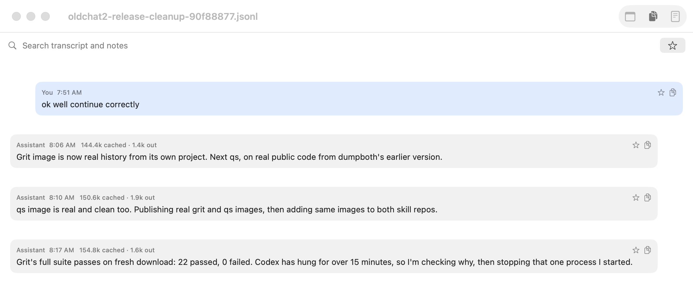

# DBV

Claude Code skill and Mac app: `/dbv` builds and maintains chat viewer for chats you save with
[dumpboth](https://github.com/towelWet/dumpboth).



## Install

```sh
cp -R skills/* ~/.claude/skills/
```

Then `/dbv` in Claude Code, or build directly:

```sh
~/.claude/skills/dumpboth/DBV/build.command
```

App code lives at `skills/dumpboth/DBV/`, beside dumpboth, because that is where this skill keeps it.
Build needs Swift 6.2+ on Apple silicon and installs to `/Applications/DBV.app`.

Full instructions: [skills/dbv/SKILL.md](skills/dbv/SKILL.md).

## See also

[dumpconvert](https://github.com/towelWet/dumpconvert): turn saved chats into training dataset.
